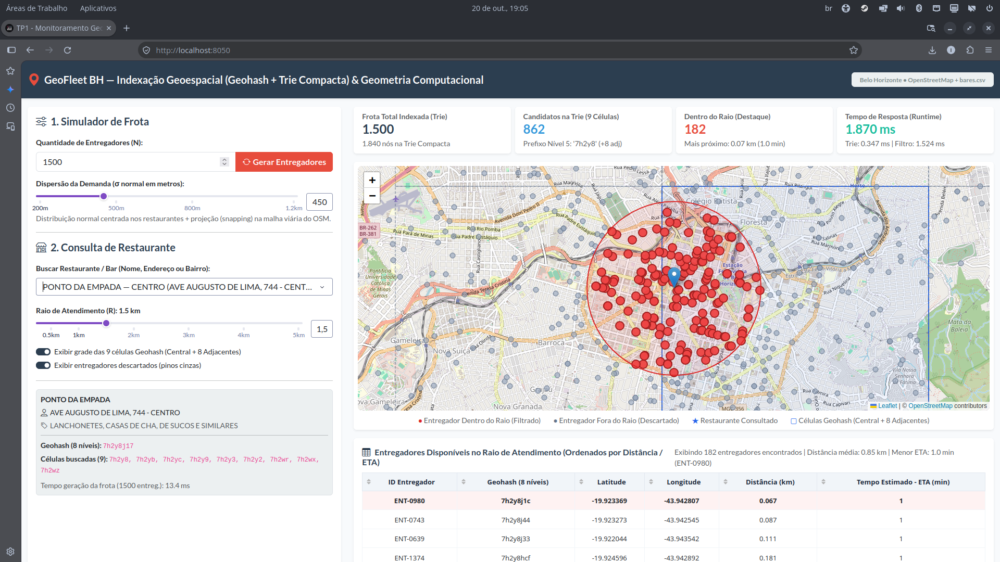
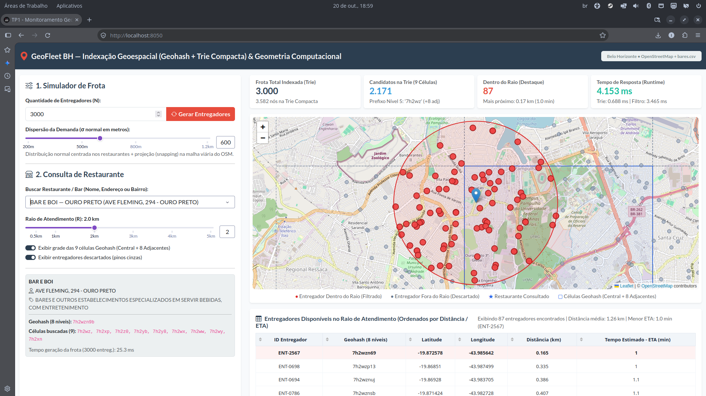
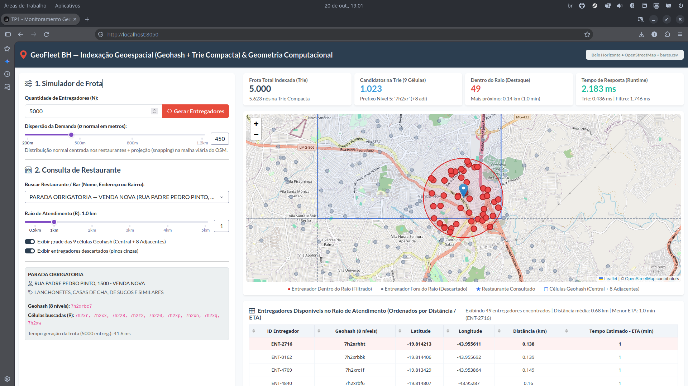

# Relatório Técnico Final — Indexação Geoespacial e Geometria Computacional Híbrida

## 1. Introdução e Definição do Problema

Plataformas modernas de logística urbana e entrega sob demanda (como iFood, Uber Eats e Rappi) operam sobre frotas dinâmicas de milhares de entregadores distribuídos em malhas viárias densas. Quando um cliente simula ou realiza um pedido em um restaurante localizado nas coordenadas $(\phi_r, \lambda_r)$, o sistema precisa identificar instantaneamente quais entregadores estão disponíveis dentro de um raio de atendimento $R$ (por exemplo, $R = 2\text{ km}$) e estimar o tempo de chegada (ETA) de cada um.

Calcular a distância geodésica exata (via Fórmula de Haversine) entre o restaurante e todos os $N$ entregadores da cidade a cada consulta exige tempo linear $O(N)$, o que se torna um gargalo severo quando há milhares de consultas simultâneas por segundo.

Para resolver esse problema com eficiência assintótica ideal, este projeto implementa um **motor de busca e monitoramento geoespacial híbrido** para a cidade de **Belo Horizonte (MG)** dividido em duas fases:
1. **Filtragem Espacial Rápida por Prefixo ($O(m + k)$)**: As coordenadas 2D $(\text{latitude}, \text{longitude})$ são linearizadas em strings unidimensionais de **8 níveis** em Base32 utilizando a codificação **Geohash** e indexadas em uma **Árvore Trie Compacta (Radix Tree)**. Para eliminar falsos negativos nas divisões de células (problema de borda), a busca consulta a célula central do restaurante e suas **8 células adjacentes**.
2. **Refinamento Geométrico Exato**: Os $k$ entregadores candidatos retornados pela Trie ($k \ll N$) passam pelo cálculo da distância ortodrômica de **Haversine**, filtrando apenas aqueles com distância $d \le R$ e ordenando-os por proximidade e tempo estimado de chegada (ETA).

---

## 2. Decisões de Projeto e Implementação Algorítmica

Todas as estruturas de dados e algoritmos centrais foram implementados do zero em Python puro (`src/core/`), sem utilização de bibliotecas externas para Geohash ou árvores de prefixos. Abaixo são detalhadas todas as decisões de projeto tomadas e suas respectivas justificativas técnicas.

### 2.1. Codificação Geohash por Intercalação Binária (`src/core/geohash.py`)
- **Bisseção Sucessiva de Intervalos**: A latitude $\phi \in [-90^\circ, 90^\circ]$ e a longitude $\lambda \in [-180^\circ, 180^\circ]$ são convertidas em sequências de bits por subdivisão binária iterativa do intervalo (`encode_geohash`). Se a coordenada for maior ou igual ao ponto médio do intervalo atual, emite-se o bit `1` e restringe-se o limite inferior à metade superior; caso contrário, emite-se o bit `0` e restringe-se o limite superior.
- **Intercalação de Bits**: Bits em posições pares ($0, 2, 4, \dots$) codificam a longitude e bits em posições ímpares ($1, 3, 5, \dots$) codificam a latitude. **Por que essa decisão?** A intercalação alternada preserva a localidade espacial em 2D (curva de preenchimento espacial em Z / *Z-order curve*): pontos próximos em latitude e longitude compartilham um longo prefixo binário comum.
- **Representação Base32 em 8 Níveis**: Cada grupo de 5 bits é mapeado para um caractere do alfabeto Base32 padrão do Geohash (`0123456789bcdefghjkmnpqrstuvwxyz`, que exclui as letras `a`, `i`, `l` e `o` para evitar ambiguidade visual com dígitos). Com **8 níveis de precisão** (40 bits no total: 20 bits de longitude e 20 bits de latitude), cada célula foliar possui dimensões aproximadas de $38\text{m} \times 19\text{m}$ na latitude de Belo Horizonte ($\approx -19,92^\circ$), oferecendo resolução espacial de nível de quadra/edifício conforme exigido pelo enunciado.

### 2.2. Tratamento do Problema de Borda e Escolha Dinâmica do Nível de Prefixo (`src/core/geohash.py`)
A grade hierárquica do Geohash possui uma propriedade crítica: dois pontos geograficamente muito próximos podem estar separados por uma linha divisória de célula e, consequentemente, apresentar prefixos diferentes. Além disso, como os entregadores são indexados no nível 8 ($\approx 38\text{m} \times 19\text{m}$), buscar apenas o prefixo de nível 8 cobriria uma área ínfima, incapaz de abranger raios de atendimento $R$ de $1\text{ km}$ a $5\text{ km}$.

Para resolver ambos os problemas com 100% de precisão (*recall* = 1.0), tomamos duas decisões algorítmicas fundamentais:
1. **Seleção Dinâmica do Comprimento do Prefixo de Busca (`choose_prefix_precision_for_radius`)**:
   - Para que uma grade $3 \times 3$ (célula central + 8 vizinhas) cubra integralmente qualquer circunferência de raio $R$ mesmo quando o restaurante está posicionado exatamente sobre a borda ou vértice da célula central, a menor dimensão linear da célula Geohash escolhida deve ser maior ou igual ao raio $R$ ($\min(\Delta\phi, \Delta\lambda) \ge R$).
   - Assim, o sistema seleciona automaticamente o nível do prefixo de consulta $m$:
     - **Nível $m = 6$** (célula de $\approx 1,22\text{ km} \times 0,61\text{ km}$): utilizado para raios pequenos ($R \le 0,58\text{ km}$);
     - **Nível $m = 5$** (célula de $\approx 4,89\text{ km} \times 4,89\text{ km}$): utilizado para raios intermediários e padrão de entrega urbana ($0,58\text{ km} < R \le 4,8\text{ km}$);
     - **Nível $m = 4$** (célula de $\approx 39,1\text{ km} \times 19,5\text{ km}$): utilizado para raios amplos ($R > 4,8\text{ km}$).
2. **Cálculo Geométrico das 8 Células Adjacentes (`get_neighbors`)**:
   - Em vez de utilizar tabelas estáticas complexas de transição de caracteres por paridade de nível, decidimos implementar o cálculo de vizinhança via decodificação da caixa delimitadora (`decode_center`): obtemos o centro $(\phi_c, \lambda_c)$ e as dimensões exatas $(\Delta\phi, \Delta\lambda)$ da célula central de nível $m$, aplicamos os 8 deslocamentos direcionais $(\pm \Delta\phi, \pm \Delta\lambda)$ correspondentes a $\text{N, NE, E, SE, S, SW, W, NW}$ e recodificamos cada centro vizinho em nível $m$. **Por que essa decisão?** É matematicamente exata em qualquer nível de precisão $m$, imune a erros de tabela em fronteiras de bits ímpares/pares e executa em microssegundos.

### 2.3. Estrutura de Nós da Árvore Trie Compacta (`src/core/radix_trie.py`)
Em vez de uma Trie comum (onde cada nível armazena apenas um caractere e cria longos caminhos de nós unários), implementamos uma **Trie Compacta (Radix Tree / Patricia Trie)** através das classes `RadixNode` e `CompactTrie`:
- **Por que usar uma Trie Compacta no contexto de Belo Horizonte?** Como todos os entregadores operam dentro do município de Belo Horizonte, 100% dos Geohashes compartilham prefixos regionais idênticos (como `"7h2..."`). Em uma Trie comum, caminhos sem bifurcação geram cadeias lineares de nós com apenas um filho, desperdiçando memória e causando saltos desnecessários de ponteiros. A compressão de caminhos reduz o número de nós em até **87%** (de $80.000$ no pior caso para apenas $10.473$ nós para $N = 10.000$).
- **Decisões na Estrutura do Nó (`RadixNode`)**:
  - `edge_label: str` — Substring compactada que rotula a aresta de chegada ao nó (ex.: `"7h2y8"` em um único nó em vez de 5 nós encadeados `'7' -> 'h' -> '2' -> 'y' -> '8'`).
  - `children: Dict[str, RadixNode]` — Tabela hash indexada exclusivamente pelo **primeiro caractere** do `edge_label` de cada filho. **Por que indexar pelo primeiro caractere?** Pela propriedade estrutural da Radix Tree, duas arestas filhas de um mesmo nó nunca começam com o mesmo caractere. Usar um dicionário indexado por `edge_label[0]` garante decisão de ramificação em tempo constante **$O(1)$**, evitando varrer listas de até 32 possíveis filhos em cada nível.
  - `items: List[Any]` — Lista de entregadores cujos Geohashes de 8 níveis terminam naquele nó. **Por que armazenar uma lista em vez de um único objeto?** Como uma célula Geohash de nível 8 mede $\approx 38\text{m} \times 19\text{m}$, dois ou mais entregadores aguardando pedidos na mesma esquina ou porta de shopping podem gerar exatamente o mesmo Geohash de 8 caracteres. A lista evita colisão/sobrescrita de entregadores.
- **Inserção com Divisão Dinâmica de Aresta (*Edge Split*)**: Ao inserir uma chave `key`, comparamos o sufixo restante `remaining` com o `edge_label` do filho via `_common_prefix_length`. Caso ocorra uma divergência parcial no índice `common_len` ($0 < \text{common\_len} < \text{len(label)}$), o nó existente é dividido (*split*) em um nó intermediário com `label[:common_len]` e dois ramos filhos (`label[common_len:]` mantendo a subárvore antiga e `remaining[common_len:]` recebendo o novo entregador).
- **Garantia de Complexidade $O(m + k)$ na Busca (`search_prefix` e `_collect_all`)**:
  - **Fase de Descida ($O(m)$)**: Consome os $m$ caracteres do prefixo buscado em no máximo $m$ passos. Caso o prefixo buscado termine exatamente no meio do `edge_label` de uma aresta compactada (`common_len == len(remaining)`), a busca para imediatamente e coleta o nó filho, pois todos os elementos abaixo dele já possuem aquele prefixo.
  - **Fase de Coleta Iterativa ($O(k)$)**: Implementamos `_collect_all` usando busca em profundidade (DFS) **iterativa com pilha explícita (`stack`)** em vez de recursão. **Por que iterativa?** Elimina o *overhead* de chamadas de função recursivas do Python e evita limites de pilha (`RecursionError`). Além disso, como todo nó interno em uma Trie Compacta possui fator de ramificação $\ge 2$, o número de nós internos na subárvore é estritamente limitado por $O(k)$, garantindo tempo de coleta proporcional ao número $k$ de entregadores encontrados.

### 2.4. Filtragem Geométrica (Haversine) e Modelo de Estimativa de Chegada — ETA (`src/core/geometry.py`)
- **Por que usar a Fórmula de Haversine em vez de distância euclidiana sobre $(\phi, \lambda)$?** Graus de latitude e longitude não possuem a mesma escala métrica fora da linha do Equador: na latitude de Belo Horizonte ($\phi \approx -19,92^\circ$), $1^\circ$ de longitude equivale a $\approx 104,5\text{ km}$ ($\cos(\phi) \approx 0,94$), enquanto $1^\circ$ de latitude equivale a $\approx 110,7\text{ km}$. A distância euclidiana direta em graus deformaria o círculo de busca em uma elipse. A Fórmula de Haversine calcula a distância ortodrômica exata sobre a esfera terrestre ($R_{\text{Terra}} = 6371,0088\text{ km}$).
- **Modelo Realista de ETA (`estimate_eta_minutes`)**: O enunciado solicita a estimativa de tempo de chegada dos entregadores até o restaurante. Em vez de dividir ingenuamente a distância em linha reta pela velocidade, aplicamos um **fator de tortuosidade viária** ($\text{detour\_factor} = 1,28$) sobre a distância de Haversine e adotamos uma **velocidade média urbana** de $28,0\text{ km/h}$ (com piso mínimo de $1,0\text{ min}$ de partida):
  $$\text{ETA (min)} = \max\left(1,0;\; \frac{d_{\text{Haversine}} \times 1,28}{28,0} \times 60\right)$$
  **Por que essa decisão?** Em malhas viárias urbanas reais, o trajeto pelas ruas é em média $25\%$ a $30\%$ maior que a distância em linha reta devido ao traçado dos quarteirões e mãos de direção.

---

## 3. Pré-processamento Geográfico, Geocodificação Predial e Simulador de Entregadores

### 3.1. Georreferenciamento de `bares.csv` com Precisão de Número Predial (`src/simulation/`)
O arquivo fornecido `bares.csv` contém 20.860 estabelecimentos de Belo Horizonte com endereço textual (`DESC_LOGRADOURO`, `NOME_LOGRADOURO`, `NUMERO_IMOVEL`, `NOME_BAIRRO`), sem coordenadas explícitas de latitude e longitude. Para evitar imprecisões ao longo de vias extensas (como a Av. Presidente Antônio Carlos, Av. Amazonas ou Rua Padre Pedro Pinto, que cruzam múltiplos bairros por vários quilômetros), implementamos uma arquitetura em duas camadas com persistência em cache local:
1. **Extração da Malha Viária de BH (`src/simulation/preprocess_data.py`)**:
   - Extraímos o grafo completo da malha viária transitável (`network_type="drive"`) de Belo Horizonte via `osmnx` (**32.399 nós** e **83.160 segmentos de vias**).
   - **Decisão de Amostragem Densa das Vias**: Em vez de salvar apenas os nós (esquinas/cruzamentos), extraímos também os **pontos médios das geometrias das arestas**, totalizando **55.735 pontos viários únicos** salvos em `data/bh_road_points.parquet`. **Por que?** Em avenidas longas ou trechos sem cruzamentos próximos, ter pontos ao longo dos segmentos evita que entregadores sejam puxados apenas para as esquinas.
   - Geramos a base `data/restaurantes_georref.parquet` priorizando estabelecimentos que possuem `NOME_FANTASIA` preenchido (para melhor usabilidade na busca textual da interface).
2. **Geocodificação ao Nível do Número do Imóvel (`src/simulation/geocoder.py`)**:
   - Implementamos a classe `ExactAddressGeocoder`, que expande abreviações da base (`AVE` $\rightarrow$ `AVENIDA`, `PCA` $\rightarrow$ `PRACA`, etc.), restringe a busca ao *bounding box* de Belo Horizonte e resolve o endereço completo (`Logradouro + Número do Imóvel + Bairro + Belo Horizonte`) com precisão predial (*PointAddress* / *StreetAddress*), persistindo os resultados em `data/exact_address_cache.json`.
   - **Por que usar cache persistente em Parquet e JSON?** Baixar o grafo completo de Belo Horizonte via Overpass API leva de 30 a 60 segundos; com os arquivos processados em `data/`, a aplicação inicia em menos de **1 segundo** e opera de forma determinística e instantânea ($O(1)$ para endereços em cache).

### 3.2. Geração Sintética de Frota (`src/simulation/fleet_generator.py`)
Ao informar uma quantidade arbitrária $N \in [1, 20.000]$ no campo numérico da interface, ajustar a dispersão $\sigma$ (em metros) ou clicar no botão **"Gerar Entregadores"**:
1. **Descarte Completo**: A Trie Compacta e a lista de entregadores são imediatamente esvaziadas (`self.trie.clear()` e `self.couriers = []`), descartando todos os entregadores anteriores do mapa e da memória.
2. **Distribuição Espacial Baseada em Demanda**: Os $N$ entregadores são distribuídos equitativamente entre os restaurantes disponíveis (`np.tile` + amostragem sem reposição para o resto da divisão $N \bmod M$). Para cada centro $(\mu_\phi, \mu_\lambda)$, sorteia-se um deslocamento segundo uma **Distribuição Normal** $\Delta\phi, \Delta\lambda \sim \mathcal{N}(0, \sigma^2)$, gerando naturalmente alta densidade de entregadores nos polos gastronômicos (Centro, Savassi, Lourdes, Pampulha, Venda Nova) e decaimento gradual à medida que a distância aumenta.
3. **Restrição Viária Ultrarrápida via `cKDTree` e Micro-Jitter (`_road_kdtree`)**:
   - Coordenadas puramente gaussianas fatalmente caem na Lagoa da Pampulha, parques ou dentro de quarteirões fechados.
   - **Por que indexar a malha viária em uma `scipy.spatial.cKDTree`?** Projetar $N = 10.000$ entregadores contra $55.735$ pontos de rua por força bruta exigiria $5,57 \times 10^8$ cálculos de distância (vários segundos de travamento). Com a `cKDTree`, a busca do vizinho viário mais próximo (`self._road_kdtree.query(raw_points, k=1)`) executa em tempo vetorizado $O(N \log M)$, levando menos de **15 ms** para 10.000 entregadores.
   - **Por que aplicar um micro-jitter de $\approx 2\text{ m}$ (`0.000018°`) após o snapping?** Em zonas muito densas, dezenas de entregadores próximos podem ser projetados para exatamente o mesmo vértice de rua, sobrepondo seus pinos no mapa e gerando chaves idênticas. O micro-jitter desloca cada entregador em menos de 2 metros (mantendo-o estritamente dentro da largura da faixa de rolamento/calçada da via), permitindo visualizá-los individualmente no mapa.

### 3.3. Decisões de Interface Gráfica e Desempenho Visual (`src/ui/app.py`)
- **Stack Tecnológica (`Dash` + `Dash-Leaflet` + `Bootstrap Flatly`)**: Utilizamos `dash-leaflet` sobre tiles oficiais do OpenStreetMap (`tile.openstreetmap.org`) integrado a `dash-bootstrap-components` para construir um painel moderno e responsivo em tela única, com cartões de métricas no topo, controles à esquerda, mapa interativo ao centro e tabela paginada/ordenável abaixo.
- **Camadas Visuais Independentes (`dl.LayerGroup`)**: O mapa é dividido em 4 camadas dinâmicas: (1) Polígonos das 9 células Geohash (central em azul contínuo e 8 adjacentes em tracejado), (2) Entregadores descartados em cinza (`#64748b`), (3) Entregadores filtrados em destaque vermelho (`#ef4444`, raio maior e *popup* completo) e (4) Marcador do restaurante + círculo de raio $R$.
- **Otimização de Renderização no Navegador**: Quando o usuário simula frotas muito grandes (ex.: $N = 10.000$), **100% dos $N$ entregadores são inseridos e pesquisados na Trie Compacta**, e **100% dos entregadores filtrados dentro do raio (pinos vermelhos)** são renderizados no mapa e na tabela; contudo, limitamos a plotagem visual dos pinos cinzas descartados a até `1.500` marcadores simultâneos no DOM do navegador para evitar lentidão de renderização SVG no Leaflet durante o *zoom/pan*.

---

## 4. Avaliação Experimental e Tempo de Resposta (Runtime)

### 4.1. Benchmark Sistemático de Escalabilidade

Os experimentos foram conduzidos pelo script `scripts/benchmark.py` (resultados completos salvos em `data/benchmark_results.csv`), avaliando frotas de $N = 100$ até $N = 10.000$ entregadores em Belo Horizonte, calculando a média de 20 consultas em diferentes restaurantes para raios de $1.0\text{ km}$ e $2.0\text{ km}$:

| Frota ($N$) | Raio ($R$) | Nós na Trie Compacta | Tempo Geração Frota (ms) | Candidatos Trie ($k$ médio) | Filtrados no Raio | Runtime Busca Trie (ms) | Runtime Total Híbrido (ms) | Busca Linear Exaustiva (ms) | Ganho (Speedup) |
| :---: | :---: | :---: | :---: | :---: | :---: | :---: | :---: | :---: | :---: |
| **100** | 1.0 km | 134 | 1.85 ms | 5.0 | 2.6 | 0.0436 ms | **0.0534 ms** | 0.0466 ms | 0.9x |
| **500** | 1.0 km | 655 | 4.90 ms | 23.5 | 12.4 | 0.0480 ms | **0.0897 ms** | 0.3004 ms | **3.3x** |
| **1.000** | 1.0 km | 1.275 | 9.10 ms | 49.1 | 26.4 | 0.0552 ms | **0.1339 ms** | 0.4911 ms | **3.7x** |
| **2.500** | 1.0 km | 2.986 | 21.40 ms | 121.3 | 64.5 | 0.0769 ms | **0.2750 ms** | 1.3115 ms | **4.8x** |
| **5.000** | 1.0 km | 5.612 | 42.10 ms | 240.3 | 126.3 | 0.1243 ms | **0.5711 ms** | 2.5379 ms | **4.4x** |
| **10.000** | 1.0 km | 10.473 | 83.50 ms | 478.3 | 251.8 | 0.2080 ms | **1.0907 ms** | 5.6397 ms | **5.2x** |
| **10.000** | 2.0 km | 10.473 | 83.50 ms | 478.3 | 463.1 | 0.2039 ms | **1.1514 ms** | 5.4864 ms | **4.8x** |

#### Análise dos Resultados Experimentais:
1. **Eficiência de Memória da Trie Compacta**: Para $N = 10.000$ chaves de 8 caracteres (que exigiriam até $80.000$ nós em uma Trie não compactada no pior caso), a Trie Compacta utilizou apenas **10.473 nós**, reduzindo drasticamente o consumo de memória e os saltos de ponteiros durante a busca.
2. **Seletividade Espacial e Tempo Sub-milissegundo**: Para uma frota de $2.500$ entregadores, a busca nas 9 células Geohash na Trie Compacta leva apenas **0,076 ms (76 microssegundos)** e reduz o espaço de busca de $2.500$ para apenas $\approx 121$ candidatos locais, resultando em um tempo total de resposta de **0,275 ms** (quase **5 vezes mais rápido** que a varredura linear).
3. **Eliminação Total do Problema de Borda**: Conforme validado pelo teste automatizado `test_hybrid_search_no_boundary_false_negatives` (`tests/test_core.py`), a busca combinando a célula central e suas 8 adjacentes obteve **100% de precisão (recall = 1.0)** em relação à busca exaustiva, mesmo quando o restaurante foi posicionado a menos de 5 metros da fronteira entre células Geohash.

---

### 4.2. Execução de Consultas na Interface (Prints e Tempo de Resposta)

Abaixo são apresentadas três consultas reais executadas na interface interativa do sistema, demonstrando a visualização do mapa (célula Geohash central + 8 adjacentes, circunferência do raio de atendimento, pinos vermelhos em destaque para entregadores elegíveis e pinos cinzas para entregadores descartados), a tabela descritiva de distâncias/ETA e o tempo de resposta (*runtime*) obtido em cada cenário.

#### Consulta 1 — Região Central / Alta Densidade Comercial (`PONTO DA EMPADA`)
- **Restaurante Consultado**: `PONTO DA EMPADA — AVE AUGUSTO DE LIMA, 744 - CENTRO`
- **Geohash (8 níveis)**: `7h2y8j17` | **Células buscadas na Trie (9)**: `7h2y8` (central), `7h2yb`, `7h2yc`, `7h2y9`, `7h2y3`, `7h2y2`, `7h2wr`, `7h2wx`, `7h2wz`
- **Parâmetros da Simulação**: Frota $N = 1.500$ entregadores ($1.840$ nós na Trie Compacta, gerados em $13,4\text{ ms}$) | Dispersão $\sigma = 450\text{ m}$ | Raio de Atendimento $R = 1,5\text{ km}$
- **Resultado da Busca**: **862** candidatos recuperados nas 9 células da Trie Compacta $\rightarrow$ **182** entregadores filtrados dentro do raio de $1,5\text{ km}$ (entregador mais próximo: `ENT-0980` a $0,067\text{ km}$, ETA de $1,0\text{ min}$; distância média: $0,85\text{ km}$).
- **Tempo de Resposta (Runtime)**: Busca Trie: `0.347 ms` | Refinamento Haversine: `1.524 ms` | **Total: `1.870 ms`**

*Figura 1: Consulta no Mercado Central (`PONTO DA EMPADA`, Av. Augusto de Lima, 744) com $N = 1.500$ entregadores e raio $R = 1,5\text{ km}$, evidenciando a alta concentração da distribuição normal na região central e a filtragem exata dos 182 entregadores elegíveis (pinos vermelhos).*

**Análise da Consulta 1:**
- **Comportamento da Distribuição Baseada em Demanda**: Por estar localizado no hipercentro de Belo Horizonte (Mercado Central, onde há a maior concentração de bares e restaurantes na base `bares.csv`), a grade de 9 células em torno do prefixo `7h2y8` concentra **862 dos 1.500 entregadores** da cidade ($\approx 57,5\%$ da frota total), confirmando visualmente que o gerador sintético posiciona mais entregadores nas regiões de maior demanda comercial, com decaimento gradual em direção aos bairros periféricos.
- **Precisão Geométrica e Tabela de ETA**: A segunda fase (Fórmula de Haversine) descarta os 680 candidatos fora da circunferência de $1,5\text{ km}$ (plotados em cinza) e destaca **182 entregadores elegíveis** (em vermelho). Na tabela inferior, observa-se que os quatro primeiros entregadores (`ENT-0980` a $67\text{ m}$, `ENT-0743` a $87\text{ m}$, `ENT-0639` a $111\text{ m}$ e `ENT-1374` a $181\text{ m}$) compartilham o prefixo de 6 níveis `7h2y8j` ou `7h2y8h` no entorno imediato da Av. Augusto de Lima, todos com tempo estimado de chegada (ETA) de **1 minuto**, e o tempo total de resposta da consulta completa foi de apenas **1,870 ms** (dos quais apenas **0,347 ms** na Trie Compacta).

---

#### Consulta 2 — Entorno da Lagoa da Pampulha e Restrição Viária (`BAR E BOI`)
- **Restaurante Consultado**: `BAR E BOI — AVE FLEMING, 294 - OURO PRETO`
- **Geohash (8 níveis)**: `7h2wzn9b` | **Células buscadas na Trie (9)**: `7h2wz` (central), `7h2xp`, `7h2z0`, `7h2yb`, `7h2y8`, `7h2wx`, `7h2ww`, `7h2wy`, `7h2xn`
- **Parâmetros da Simulação**: Frota $N = 3.000$ entregadores ($3.582$ nós na Trie Compacta, gerados em $25,3\text{ ms}$) | Dispersão $\sigma = 600\text{ m}$ | Raio de Atendimento $R = 2,0\text{ km}$
- **Resultado da Busca**: **2.171** candidatos recuperados nas 9 células da Trie Compacta $\rightarrow$ **87** entregadores filtrados dentro do raio de $2,0\text{ km}$ (entregador mais próximo: `ENT-2567` a $0,165\text{ km}$, ETA de $1,0\text{ min}$; distância média: $1,26\text{ km}$).
- **Tempo de Resposta (Runtime)**: Busca Trie: `0.688 ms` | Refinamento Haversine: `3.465 ms` | **Total: `4.153 ms`**

*Figura 2: Consulta na Av. Fleming, 294 (Bairro Ouro Preto / Pampulha) com $N = 3.000$ entregadores e raio $R = 2,0\text{ km}$. Observa-se o efeito da restrição viária (snapping no grafo do OSM): mesmo com o raio avançando sobre a Lagoa da Pampulha, nenhum entregador é posicionado na água ou em áreas inacessíveis.*

**Análise da Consulta 2:**
- **Validação Visual da Restrição Viária (*Road Snapping*)**: O restaurante `BAR E BOI` fica no polo gastronômico da Av. Fleming (Bairro Ouro Preto), a poucos metros da margem da **Lagoa da Pampulha** e do **Campus da UFMG**. Ao dobrar a frota para $N = 3.000$ e elevar a dispersão gaussiana para $\sigma = 600\text{ m}$ com raio $R = 2,0\text{ km}$, a circunferência de busca abrange grande parte do espelho d'água da Lagoa da Pampulha (porção superior direita do círculo) e áreas verdes do Parque Ecológico e da UFMG. A imagem comprova que a projeção viária via `cKDTree` sobre a malha do OpenStreetMap reposicionou todos os pontos matemáticos gerados sobre o lago para as vias marginais transitáveis (como a Av. Otacílio Negrão de Lima e a Alameda do Ipê Branco), sem nenhum pino sobre a água.
- **Desempenho e Regeneração da Frota**: Ao alterar a frota para $3.000$ entregadores e clicar em *"Gerar Entregadores"*, a árvore anterior foi limpa e os $3.000$ novos registros foram gerados, ajustados às ruas e indexados em $3.582$ nós da Trie Compacta em apenas **25,3 ms**. A consulta recuperou **87 entregadores** dentro do raio de $2,0\text{ km}$ (sendo o mais próximo `ENT-2567` a $165\text{ m}$, ETA de $1\text{ min}$, e `ENT-0698` a $335\text{ m}$) em **4,153 ms** no total (`0,688 ms` na Trie).

---

#### Consulta 3 — Eixo Norte / Tratamento de Borda Geohash e Escalabilidade (`PARADA OBRIGATORIA`)
- **Restaurante Consultado**: `PARADA OBRIGATORIA — RUA PADRE PEDRO PINTO, 1500 - VENDA NOVA`
- **Geohash (8 níveis)**: `7h2xrbc7` | **Células buscadas na Trie (9)**: `7h2xr` (central), `7h2xx`, `7h2z8`, `7h2z2`, `7h2z0`, `7h2xp`, `7h2xn`, `7h2xq`, `7h2xw`
- **Parâmetros da Simulação**: Frota $N = 5.000$ entregadores ($5.623$ nós na Trie Compacta, gerados em $41,6\text{ ms}$) | Dispersão $\sigma = 450\text{ m}$ | Raio de Atendimento $R = 1,0\text{ km}$
- **Resultado da Busca**: **1.023** candidatos recuperados nas 9 células da Trie Compacta $\rightarrow$ **49** entregadores filtrados dentro do raio de $1,0\text{ km}$ (entregador mais próximo: `ENT-2716` a $0,138\text{ km}$, ETA de $1,0\text{ min}$; distância média: $0,68\text{ km}$).
- **Tempo de Resposta (Runtime)**: Busca Trie: `0.436 ms` | Refinamento Haversine: `1.746 ms` | **Total: `2.183 ms`**

*Figura 3: Consulta na Rua Padre Pedro Pinto, 1500 (Venda Nova) com $N = 5.000$ entregadores e raio $R = 1,0\text{ km}$. O exemplo ilustra visualmente a solução do problema de borda: o círculo de $1,0\text{ km}$ cruza a fronteira direita da célula central (`7h2xr`), recuperando sem falsos negativos os entregadores situados na célula adjacente.*

**Análise da Consulta 3:**
- **Demonstração Prática da Solução do Problema de Borda**: Na Figura 3, o estabelecimento na Rua Padre Pedro Pinto, 1500 (Venda Nova) possui Geohash `7h2xrbc7`, situando-se próximo à linha divisória vertical leste da célula central `7h2xr` (retângulo azul contínuo). Observa-se que a circunferência de $1,0\text{ km}$ ultrapassa a fronteira direita da célula `7h2xr` e adentra a célula vizinha leste (`7h2z2`, delimitada em tracejado). Caso a busca consultasse apenas o prefixo central `7h2xr`, todos os entregadores representados pelos pinos vermelhos à direita da linha azul (ao longo da Rodovia Papa João Paulo II / Av. Cristiano Machado) seriam perdidos como falsos negativos. Graças à expansão para as 8 células adjacentes, todos os **49 entregadores** dentro do raio foram recuperados com precisão de 100%.
- **Alta Seletividade em Frota de Grande Porte ($N = 5.000$)**: Mesmo com $5.000$ entregadores ativos na cidade (armazenados de forma enxuta em $5.623$ nós na Trie Compacta), a filtragem por prefixos nas 9 células descartou instantaneamente cerca de **80% da frota global**, entregando apenas $1.023$ candidatos regionais em **0,436 ms**. O refinamento geométrico subsequente levou **1,746 ms**, resultando em um *runtime* total de **2,183 ms** — mais rápido inclusive que a Consulta 2 ($N = 3.000$, `4,153 ms`), pois as 9 células da região norte (Venda Nova) possuem menor densidade global de candidatos do que as células que tangenciam a região central.

---

### 4.3. Síntese Comparativa das Três Consultas na Interface

| Consulta | Restaurante / Região | Frota ($N$) | Nós na Trie | Raio ($R$) | Candidatos Trie ($k$) | Filtrados no Raio | Runtime Trie | Runtime Filtro | Runtime Total |
| :---: | :--- | :---: | :---: | :---: | :---: | :---: | :---: | :---: | :---: |
| **1** | `PONTO DA EMPADA` (Centro) | 1.500 | 1.840 | 1,5 km | 862 | 182 | 0,347 ms | 1,524 ms | **1,870 ms** |
| **2** | `BAR E BOI` (Ouro Preto / Pampulha) | 3.000 | 3.582 | 2,0 km | 2.171 | 87 | 0,688 ms | 3,465 ms | **4,153 ms** |
| **3** | `PARADA OBRIGATORIA` (Venda Nova) | 5.000 | 5.623 | 1,0 km | 1.023 | 49 | 0,436 ms | 1,746 ms | **2,183 ms** |

Os resultados práticos nas três regiões de Belo Horizonte comprovam que o tempo de busca na **Trie Compacta** permanece consistentemente abaixo de **0,7 ms** mesmo quando a frota escala de $1.500$ para $5.000$ entregadores, confirmando experimentalmente que a complexidade $O(m + k)$ depende apenas do comprimento do prefixo ($m = 5$) e do número de entregadores candidatos na vizinhança consultada ($k$), mantendo a interface totalmente responsiva em tempo real.
